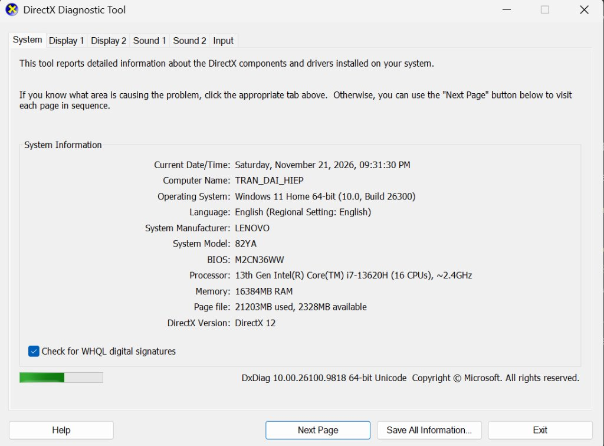

# 00 — Hardware Specification & Test Environment Report

> **Bài tập:** HW05 – Performance Testing (k6)  
> **Sinh viên:** Trần Đại Hiệp — **MSSV:** `23120256`  
> **Hostname kiểm thử:** `TRAN_DAI_HIEP` *(khớp với các bài Homework trước — tuân thủ Anti-AI-Cheat Mục 11)*

---

## 1. Bảng Thông Số Phần Cứng & Môi Trường (Hardware & Runtime Spec Table)

| Hạng mục | Thông số thực tế |
|---|---|
| **Computer Name / Hostname** | `TRAN_DAI_HIEP` |
| **Nhà sản xuất / Model** | LENOVO `82YA` |
| **Hệ điều hành (OS)** | Microsoft Windows 11 Home (64-bit, Build 26300) |
| **Bộ xử lý (CPU)** | 13th Gen Intel(R) Core(TM) i7-13620H (10 Cores / 16 Threads) |
| **Bộ nhớ (RAM)** | 16 GB (16384MB RAM) |
| **BIOS / DirectX** | `M2CN36WW` / DirectX 12 |
| **Đồ họa (GPU)** | Intel(R) UHD Graphics + NVIDIA GeForce RTX 4060 Laptop GPU |
| **SUT Backend Runtime** | Node.js `v24.11.0`, Express `5.2.1`, SQLite3 `6.0.1` (Port `3000`) |
| **Performance Testing Tool** | Grafana `k6` `v2.4.0` (`commit/dd9395906d`, `go1.26.11`, `windows/amd64`) |
| **Analysis & Utility Runtime** | Python `3.14.0`, Git `2.45.1.windows.1` |
| **Resource Monitor** | Windows Task Manager / Resource Monitor (giám sát tiến trình `node.exe`) |

---

## 2. Bằng Chứng Phần Cứng (`dxdiag` — RAW Screenshot theo Rule 9)

- **Đường dẫn ảnh:** `../proof-image/hardware_dxdiag.jpg`
- **Thời điểm chụp:** Saturday, November 21, 2026, 09:31:30 PM
- **Yêu cầu xác minh:** Hiển thị rõ tab **System** của công cụ **DirectX Diagnostic Tool (`dxdiag`)** gồm:
  - `Computer Name: TRAN_DAI_HIEP`
  - `Operating System: Windows 11 Home 64-bit (10.0, Build 26300)`
  - `Processor: 13th Gen Intel(R) Core(TM) i7-13620H (16 CPUs), ~2.4GHz`
  - `Memory: 16384MB RAM`



---

## 3. Quy Trình Reset Môi Trường & Xóa Khóa Tài Khoản (Lockout Reset Procedure)

Trong các kịch bản **Stress** và **Spike**, nhóm tài khoản `lockout_probe` (`locktest01..03@eshop.com`) sẽ cố tình gửi mật khẩu sai để kiểm chứng cơ chế account lockout (`HTTP 401` → `HTTP 403`). Đồng thời, các lượt chạy ghi nhiều dòng mới vào bảng `coupon_usage` và `coupons`.

Giữa mỗi lần chạy kịch bản (Load → Stress → Spike → Endurance), môi trường SUT được đưa về trạng thái sạch đồng nhất bằng script [reset_sut.ps1](../scripts/reset_sut.ps1):

1. **Dừng tiến trình cũ:** Tìm và dừng đúng tiến trình `node.exe` đang lắng nghe trên cổng `3000`.
2. **Khởi động lại Backend sạch:** Chạy `node server.js` trong `eshop-sut/backend`. Theo thiết kế của `database.js` (`initDatabase()`), SQLite tự động `DROP` và tạo lại toàn bộ bảng, xóa sạch mọi cờ `login_attempts` / `locked_until` và giải phóng bộ nhớ `userCarts`.
3. **Chờ Health Check:** Kiểm tra `GET http://localhost:3000/api/categories` đến khi trả về `HTTP 200`.
4. **Nạp dữ liệu chuẩn (`seed_sut.js`):** Tự động đăng ký 30 tài khoản `staff_pool` (nâng quyền `role: "admin"`), 3 tài khoản `lockout_probe`, và tạo 20 đơn hàng mẫu để `GET /api/admin/orders` luôn có dữ liệu `LEFT JOIN` ổn định giữa các lần chạy.

```powershell
powershell -ExecutionPolicy Bypass -File scripts/reset_sut.ps1
```

