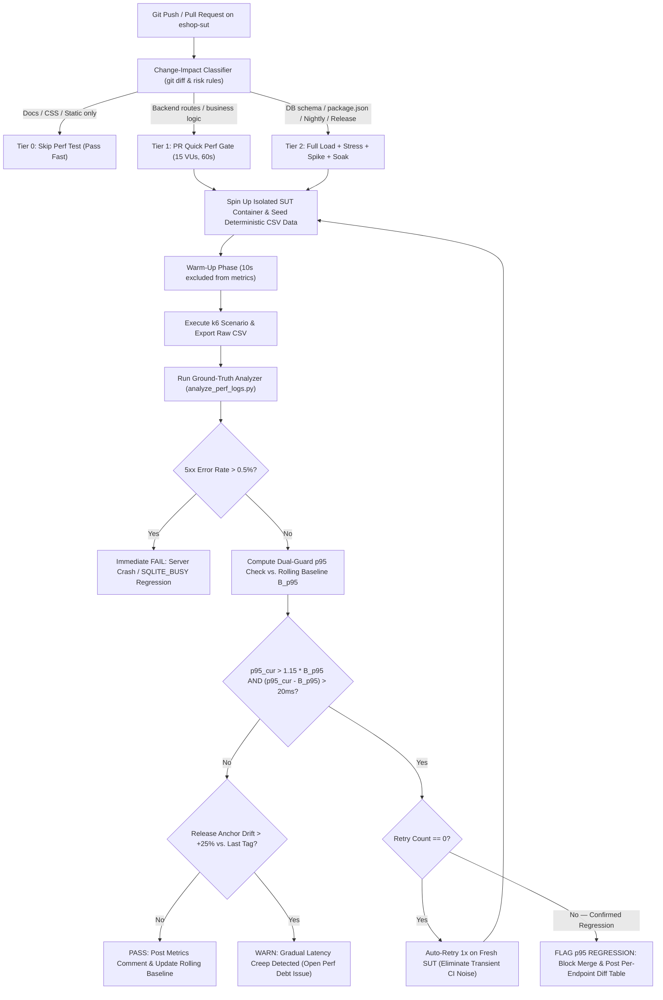

# 04 — Task 3: Continuous Performance Testing (CPT) Architecture Proposal (Bloom-AI G9.6)

> **Bài tập:** HW05 – Performance Testing (Task 3 — 10 điểm, Bloom-AI **G9.6 Disrupt**)  
> **Sinh viên:** Trần Đại Hiệp (`23120256`)  
> **Mục tiêu:** Thiết kế mô hình **Continuous Performance Testing (CPT)** tự động giám sát commit trên kho mã nguồn `eshop-sut`, quyết định thông minh khi nào cần chạy performance test, phát hiện sớm suy giảm `p95` (**p95 regression**), và cân bằng bài toán **chi phí CI vs. cảnh báo giả (false alarms)**.

---

## 1. Động Lực Thiết Kế Từ Thực Nghiệm Trên EShop

Từ dữ liệu đo thực tế ở Task 1 & Task 2 trên `eshop-sut/backend`:
- Chạy đầy đủ cả 4 kịch bản (`Load 3m` + `Stress 4m15s` + `Spike 2m40s` + `Endurance 12m`) tiêu tốn **~22 phút** cho mỗi commit — **không thể chạy trên mọi Pull Request** vì làm tắc nghẽn lập trình viên và đội chi phí CI.
- Ngược lại, nếu chỉ chạy tay trước khi release thì các lỗi nghiêm trọng như **truy vấn thiếu index `coupon_usage`** (`post_apply_coupon p95` vọt lên `648.92 ms` ở Spike) hoặc **write lock SQLite** chỉ bị phát hiện quá muộn.
- **Giải pháp (Disruptive CPT Model):** Xây dựng kiến trúc **Commit-Aware Tiered CPT** kết hợp **Rolling `p95` Regression Detector** và **Auto-Retry Noise Filtering**.

---

## 2. Kiến Trúc Phân Tầng Theo Rủi Ro Commit (Tiered Commit Classifier)

Mỗi sự kiện `git push` / `pull_request` đi qua bộ phân loại thay đổi (**Change-Impact Classifier** dựa trên `git diff --name-only` kết hợp kiểm tra AST/từ khóa SQL):

| Tầng (Tier) | Điều kiện kích hoạt (Commit Diff Rule) | Kịch bản k6 thực thi | Thời lượng CI | Hành động khi phát hiện suy giảm |
|---|---|---|---:|---|
| **Tier 0 — Skip** | Chỉ thay đổi `docs/`, `README.md`, `*.css`, ảnh/asset frontend tĩnh | **Không chạy** | `0s` | Pass tức thì (tiết kiệm 100% chi phí CI) |
| **Tier 1 — PR Quick Perf Gate** | Thay đổi `backend/server.js`, route handlers, middleware auth, logic coupon/order | **k6 Smoke Load** (`15 VUs, 60s` trên runner cố định) + `analyze_perf_logs.py` | `~90s` | Cảnh báo trên PR; **Block Merge** nếu vượt ngưỡng sau 1 lần auto-retry xác nhận |
| **Tier 2 — Nightly / Pre-Release Full Suite** | Thay đổi `backend/database.js`, schema/index, `package.json`, cron `02:00 AM` hàng đêm hoặc tag `v*.*.*` | **Full Load (3m) + Stress (4m15s) + Spike (2m40s) + Endurance (12m)** | `~22m` | Gửi cảnh báo Slack/GitHub Issue tự động + chặn phát hành Release |

---

## 3. Sơ Đồ Luồng Mô Hình Continuous Performance Testing (Flowchart)



---

## 4. Thuật Toán Phát Hiện Suy Giảm `p95` (Statistical `p95` Regression Detector)

Thay vì dùng một con số ngưỡng tĩnh cố định dễ lỗi thời, mô hình sử dụng **3 lớp bảo vệ thống kê**:

1. **Rolling Baseline ($B_{p95}$):** Trung bình động (hoặc trung vị) của `p95` trên **5 lần chạy thành công gần nhất của nhánh `main`** cho từng endpoint (VD: `post_apply_coupon`, `post_login`, `get_admin_orders`).
2. **Dual-Guard Trigger (Chống nhiễu API siêu nhanh):** Chỉ đánh cờ suy giảm khi **ĐỒNG THỜI** thỏa cả 2 điều kiện:
   $$\text{p95}_{\text{current}} > 1.15 \times B_{p95} \quad \text{AND} \quad (\text{p95}_{\text{current}} - B_{p95}) > 20\text{ ms}$$
   *Ví dụ thực tế từ EShop Load Test:* `get_users_me` có baseline `13.3 ms`. Nếu nhiễu hệ điều hành làm nó tăng lên `16.0 ms` (`+20%` tương đối, nhưng chỉ `+2.7 ms` tuyệt đối), điều kiện tuyệt đối `> 20 ms` sẽ **chặn ngay cảnh báo giả**! Ngược lại, nếu một commit làm `post_apply_coupon` tăng từ `17.2 ms` lên `55 ms` (`+220%` và `+37.8 ms > 20 ms`), hệ thống lập tức phát hiện!
3. **Release Anchor Drift Guard (Chống "Death by 1,000 Cuts"):** Nếu 10 PR liên tiếp mỗi PR làm chậm thêm `+4%` (dưới ngưỡng `+15%`), Rolling Baseline sẽ bị trôi dần (*baseline drift*). Do đó hệ thống so sánh song song với **Release Anchor Baseline** ($A_{p95}$ của bản release gần nhất) và mở cảnh báo nợ hiệu năng khi $\text{p95}_{\text{current}} > 1.25 \times A_{p95}$.
4. **Auto-Retry Confirmation (1x):** Trước khi chặn merge PR, pipeline tự động chạy lại đúng 1 lần trên container sạch. Chỉ khi **cả 2 lần liên tiếp đều vượt Dual-Guard**, PR mới bị đánh dấu `p95 Regression Confirmed`.

---

## 5. Phân Tích Chuyên Sâu Các Trade-Offs (Cost vs. False Alarms vs. Coverage)

| Trục Trade-off | Phương án cực đoan A | Phương án cực đoan B | Điểm cân bằng của mô hình đề xuất |
|---|---|---|---|
| **1. Chi phí CI & Tốc độ PR vs. Độ phủ lỗi sớm** | Chạy Full Suite 22 phút trên mọi commit → **tốn gấp 15x phút CI**, dev phải chờ 22 phút để merge 1 dòng CSS. | Chỉ chạy thủ công trước release → chi phí CI thấp nhất, nhưng **bỏ lọt bug tới cuối sprint**, khó truy commit gây lỗi (`git bisect` tốn giờ). | **Tiered Triggering:** Tier 0 bỏ qua docs/CSS; Tier 1 chỉ tốn **~90s** cho commit chạm backend; Tier 2 chạy **Nightly/Release** khi dev không phải chờ. |
| **2. Cảnh báo giả (False Alarms) vs. Bỏ lọt suy giảm (False Negatives)** | Ngưỡng quá nhạy (`> +5%` trên shared GitHub runner) → **>30% PR bị fail oan** do *noisy neighbor*, dẫn đến **alert fatigue** (dev tắt luôn perf gate!). | Ngưỡng quá lỏng (`> +100%` hoặc chỉ check `avg`) → không có false alarm nhưng **bỏ lọt hoàn toàn suy giảm tail-latency `p95/p99`**. | **Dual-Guard (`+15%` AND `+20ms`) + Warm-up 10s + Auto-Retry 1x + Release Anchor (`+25%`)**: triệt tiêu phần lớn nhiễu thoáng qua mà vẫn giữ độ nhạy cao với suy giảm thật. |
| **3. Môi trường Runner (Shared Cloud vs. Self-Hosted Dedicated)** | Shared Cloud Runner (miễn phí/rẻ) → CPU steal biến thiên 15–30%, `p95` dao động mạnh. | Dedicated Self-Hosted Perf Runner (cố định CPU/RAM, không chia sẻ) → **tốn chi phí duy trì máy riêng**, nhưng sai số đo `< 3%`. | Dùng **Shared Runner** cho Tier 0/1 (nhờ có Dual-Guard + Retry giảm nhiễu) và **1 Dedicated Runner nhỏ** cho Tier 2 Nightly/Baseline chuẩn. |
| **4. Độ chính xác của Metric vs. Chi phí lưu trữ Raw Logs** | Lưu vô thời hạn file raw k6 CSV `350 MB`/lần chạy → nhanh chóng đầy dung lượng artifact CI. | Chỉ lưu 1 dòng summary → mất khả năng truy vết endpoint nào gây chậm. | Chạy `analyze_perf_logs.py` ngay trong job CI để trích **JSON Ground-Truth chỉ ~7 KB** lưu lâu dài làm lịch sử baseline, còn raw CSV/JTL chỉ giữ **7–14 ngày** bằng artifact retention policy. |

---

## 6. Minh Họa Tích Hợp Thực Tế (GitHub Actions Reference Pipeline)

```yaml
name: Continuous Performance Testing (Tiered CPT)
on:
  pull_request:
    paths: ["backend/**", "package.json"]
  schedule:
    - cron: "0 19 * * *" # 02:00 AM ICT Nightly Tier 2

jobs:
  perf-gate:
    runs-on: ubuntu-latest
    steps:
      - uses: actions/checkout@v4
      - uses: grafana/setup-k6-action@v1
      - name: Start & Seed EShop Backend
        run: |
          node eshop-sut/backend/server.js &
          sleep 2
          node scripts/seed_sut.js
      - name: Run Tier 1 Quick Perf Gate (or Tier 2 on schedule)
        run: |
          k6 run --out csv=raw.csv test-plans/23120256_Load_20261121.js
      - name: Ground-Truth Parse & p95 Regression Check
        run: |
          python skills/performance-tester/scripts/analyze_perf_logs.py raw.csv --json current.json
          # Compare current.json p95 against rolling 5-run baseline (+15% AND +20ms dual-guard)
```
