# HW05 – Performance Testing Report on EShop REST Backend API (Grafana k6)

> **Môn học:** Kiểm thử phần mềm (Software Testing) – FIT@HCMUS  
> **Bài tập:** HW05 – Performance Testing (AI-First + Human Review)  
> **Sinh viên:** Trần Đại Hiệp — **MSSV:** `23120256`  
> **Email:** `23120256@student.hcmus.edu.vn`  
> **Hệ thống kiểm thử (SUT):** EShop REST Backend API ([https://github.com/ttbhanh/eshop-sut](https://github.com/ttbhanh/eshop-sut))  
> **Công cụ kiểm thử:** Grafana `k6 v2.4.0` *(Bonus Tool)* + Windows Task Manager + Universal Raw-Log Analyzer (`analyze_perf_logs.py`)  
> **Public GitHub Repository:** [https://github.com/Hidebray/SoftwareTesting_HW05_23120256](https://github.com/Hidebray/SoftwareTesting_HW05_23120256)  
> **Video Demo Chính (YouTube Unlisted, ≥ 6 phút):** `[TBD — Chờ cập nhật sau khi quay OBS]`  
> **Video Demo Agent Skill (YouTube Unlisted):** `[TBD — Chờ cập nhật sau khi quay OBS]`

---

## 1. Executive Summary

- **Workflow End-to-End kiểm thử (0% trùng lặp nhóm):** **Coupon Campaign, Discount Redemption & Order Monitoring** gồm **9 bước API** phủ đủ 3 nhóm **Auth-heavy** (`POST /api/login`, `GET /api/users/me`), **Read-heavy** (`GET /api/coupons`, `GET /api/admin/orders`), **Transactional** (`POST /api/admin/coupons`, `POST /api/apply-coupon`, `POST /api/coupon-usage`, `DELETE /api/admin/coupons/:id`) và **Verification** (`POST /api/apply-coupon` → `HTTP 404`).
- **Quy mô thực nghiệm thực tế:** Đã thực thi đầy đủ **4 kịch bản** (**Load**, **Stress**, **Spike**, **Endurance 12 phút**) tạo ra tổng cộng **`391,478` HTTP requests** (`4,835,557` raw k6 CSV rows) với **`0.00%` lỗi server `5xx`**, xuất đầy đủ **raw `.jtl` logs 1:1** và **3 kiểu HTML Report View khác biệt hoàn toàn**.
- **Ngưỡng chịu tải phần cứng thực nghiệm trên `TRAN_DAI_HIEP` (Endurance 12 phút, `40 VUs`):**
  - **Max Stable Sustained RPS:** **`254.86 req/s`** *(Peak 1s: **`322 req/s`**)* | **Short-Burst Ceiling (Stress):** **`600.25 req/s`** avg *(Peak 1s: **`1,278 req/s`**)*.
  - **Overall Endurance `p95`:** **`42.34 ms`** *(max tail spike `1,216.07 ms` ở cửa sổ cuối `605s–721s`)*.
  - **CPU Ceiling (`node.exe` PID `6304`):** `Avg = 3.70%` | **`Peak = 4.47%`** *(tổng 16 luồng ≈ 71.5% của 1 nhân đơn luồng Node.js)*.
  - **Memory Ceiling (`node.exe`):** `55.41 MB` (idle) → `172.40 MB` (60s warm-up) → **`177.11 MB` peak Working Set** *(Private Mem peak `213.23 MB`, độ trượt sau warm-up chỉ `+0.45 MB/phút`)*.
- **Phát hiện lỗi thật (4 GitHub Issues có labels & ảnh RAW thật):** Khóa tài khoản sớm ở lần sai thứ 2 (`BUG-HW05-01`), giảm giá `%` ra số âm làm tăng giá 10x (`BUG-HW05-02`), lỗi biên `>` ở `min_order_amount` (`BUG-HW05-03`), và nút cổ chai `POST /api/apply-coupon` (`p95` tăng **37.7x** lên **`648.92 ms`** ở Spike — `BUG-HW05-04`).
- **Task 2 (Misinterpretation Hunt):** Sử dụng đầu ra nguyên bản của `Gemini Flash` cô lập, phát hiện **6 sai số/điểm mù định lượng (`M-01 → M-06`)** và thẩm định **8 đề xuất tối ưu** (lật tẩy **4 ảo giác stack**: `bcrypt`, SQLite connection pool 30–50, PostgreSQL `autovacuum_vacuum_scale_factor`, PostgreSQL `statement_timeout`/`RETURNING *`).
- **Task 3 (CPT — G9.6) & Agent Skill (`performance-tester` `v1.0 → v1.1`):** Thiết kế mô hình Continuous Performance Testing 3 tầng kèm Dual-Guard `p95` regression detector; xây dựng Agent Skill chuẩn **tool-agnostic** và xác minh tái sử dụng PASS 100% trên nhóm endpoint mới (**Admin Product Catalog & Bulk CSV Import**, `1,632` requests).

---

## 2. Môi Trường Kiểm Thử, Phần Cứng & Quy Trình Reset SUT

### 2.1 Bảng Thông Số Phần Cứng (`TRAN_DAI_HIEP`)

| Hạng mục | Thông số thực tế |
|---|---|
| **Computer Name / Hostname** | `TRAN_DAI_HIEP` *(khớp các bài Homework trước — Anti-AI-Cheat Mục 11)* |
| **Model thiết bị** | LENOVO `82YA` (BIOS `M2CN36WW`, DirectX 12) |
| **Hệ điều hành (OS)** | Microsoft Windows 11 Home 64-bit (10.0, Build 26300) |
| **Bộ xử lý (CPU)** | 13th Gen Intel(R) Core(TM) i7-13620H (10 Cores / 16 Threads, ~2.4 GHz) |
| **Bộ nhớ (RAM)** | 16 GB (`16384MB RAM`) |
| **Đồ họa (GPU)** | Intel(R) UHD Graphics + NVIDIA GeForce RTX 4060 Laptop GPU |
| **SUT Backend Runtime** | Node.js `v24.11.0`, Express `5.2.1`, `sqlite3` `6.0.1` (`http://localhost:3000`) |
| **Performance Tool & Utilities** | Grafana `k6 v2.4.0`, Python `3.14.0`, Git `2.45.1`, Windows Task Manager |

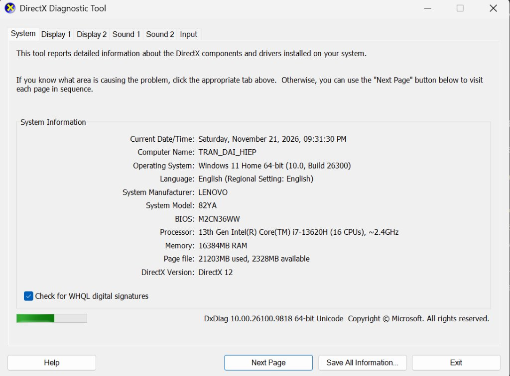

### 2.2 Quy Trình Reset Trạng Thái & Xóa Account Lockout Giữa Các Kịch Bản
Vì Stress và Spike cố tình kích hoạt cơ chế khóa tài khoản (`locked_until` 180s) trên nhóm `lockout_probe` và ghi hàng chục nghìn dòng vào `coupon_usage`, giữa mỗi kịch bản chúng tôi chạy tự động `scripts/reset_sut.ps1`:
1. Tìm và dừng toàn bộ tiến trình `node.exe` đang chạy `server.js` trên cả IPv4/IPv6 port `3000` (`netstat -ano` + `Win32_Process`), đợi 2s giải phóng port.
2. Khởi chạy mới `node server.js` trong `eshop-sut/backend/` (kích hoạt `database.js:initDatabase()` `DROP`/`CREATE` lại toàn bộ bảng, xóa sạch `locked_until`, reset `login_attempts = 0`).
3. Chờ health-check `GET /api/categories` trả `HTTP 200`.
4. Chạy `node scripts/seed_sut.js` nạp lại chuẩn xác **30 tài khoản `staff_pool` (`role: admin`)**, **3 tài khoản `lockout_probe`** (`Tổng 35 users`) và **20 đơn hàng mẫu** cho truy vấn `LEFT JOIN`.

---

## 3. Task 1 — Thiết Kế Kiểm Thử, Human Review & Thực Thi Thực Tế

### 3.1 Phạm Vi Workflow & Phân Tách Không Trùng Lặp Nhóm
- **Tránh trùng lặp:** Thành viên 1 đã đăng ký *Purchase & Order Verification* (Search/Detail/Cart/Checkout/Order History); Thành viên 2 đã đăng ký *Category Management* (Category CRUD).
- **Workflow của tôi (Pool A FR-02/FR-04 + Pool B FR-09 + Pool C FR-17/FR-18):**
  1. `POST /api/login` (**Auth-heavy**) — Pool `staff01..30` từ `data/users.csv` + scenario song song `lockout_behavior_probe` trên `locktest01..03`.
  2. `GET /api/users/me` (**Auth-heavy**) — Xác thực JWT token.
  3. `GET /api/coupons` (**Read-heavy**) — Đọc danh sách mã giảm giá.
  4. `GET /api/admin/orders` (**Read-heavy**) — Truy vấn `LEFT JOIN orders + users ORDER BY orders.id DESC`.
  5. `POST /api/admin/coupons` (**Transactional**) — Tạo coupon động từ `data/coupons.csv` (12 `fixed` + 3 `percent`).
  6. `POST /api/apply-coupon` (**Transactional/Compute**) — Áp mã với `data/redemptions.csv` (12 hợp lệ, 2 biên chính xác, 1 dưới ngưỡng), chạy `SELECT COUNT(*) FROM coupon_usage`.
  7. `POST /api/coupon-usage` (**Transactional**) — `INSERT INTO coupon_usage`.
  8. `DELETE /api/admin/coupons/:id` (**Transactional**) — Thu hồi mã giảm giá sau vòng đời.
  9. `POST /api/apply-coupon` (**Verification**) — Xác nhận mã đã xóa trả đúng `HTTP 404`.

### 3.2 Tham Số Kịch Bản (Theo Little's Law $N = \lambda \cdot (R + Z)$) & 3 Report Views Khác Nhau

| Kịch bản | File Test Plan (Đúng quy tắc tên) | Cấu hình `stages` / VUs | Think-Time | Report View (Không lặp lại) |
|---|---|---|---|---|
| **Load** | `23120256_Load_20261121.js` | `0→20 (30s) → 20 (2m) → 0 (30s)` *(3m)* | `1.0–2.5s` | **View 1:** Per-Group & Assertion Trace HTML (`html-reports/load-trace-report/index.html`) |
| **Stress** | `23120256_Stress_20261121.js` | `20→50→100→150→200 (45s/bậc) → 0 (30s)` *(4m15s)* + `lockout_probe` | `0.5–1.2s` | **View 2:** k6 Built-in Web Dashboard Time-Series HTML (`html-reports/stress-dashboard-report/index.html`) |
| **Spike** | `23120256_Spike_20261121.js` | `10 (30s) → 180 (10s) → 180 (45s) → 10 (15s) → 10 (45s) → 0 (15s)` *(2m40s)* + `lockout_probe` | `0.3–0.8s` | **View 3:** Aggregate Percentile Matrix HTML (`html-reports/spike-aggregate-report/index.html`) |
| **Endurance** | `23120256_Endurance_20261122.js` | `0→40 (30s) → 40 (11m) → 0 (30s)` *(12m)* | `0.75–1.65s` | Soak Aggregate HTML + 24-mẫu Telemetry CPU/RAM (`html-reports/endurance-soak-report/index.html`) |

### 3.3 Nhật Ký Human Review & Sửa Lỗi Bản Nháp AI (`HR-01 → HR-07`)

| ID | Lỗi / Thiếu sót của bản nháp AI | Nguyên nhân | Cách khắc phục trong bản Final |
|---|---|---|---|
| **HR-01** | Dùng trực tiếp `code_prefix` từ CSV làm `code` ở `POST /api/admin/coupons` gây lỗi `SQLITE_CONSTRAINT: UNIQUE` | Đặc thù DB schema (`database.js:31`) | Sinh mã động gắn hậu tố `${prefix}_L${__VU}_${__ITER}_${ts}` |
| **HR-02** | Trộn tài khoản test lockout vào chung pool người dùng chính làm khóa toàn bộ VU hợp lệ | Đặc thù `server.js:54` (`+2` khóa sau 2 lần sai) | Cô lập 3 tài khoản `lockout_probe` vào scenario riêng `lockout_behavior_probe` |
| **HR-03** | Assertion yếu chỉ kiểm tra `status === 200`, bỏ lọt bug giảm giá âm trên coupon `%` | Giới hạn prompt/model ban đầu | Thêm semantic check `discount_amount > 0 && final_amount < totalAmount` |
| **HR-04** | Quên đặt `http.expectedStatuses` cho bước verify `404`, đơn dưới ngưỡng `400`, và probe `401/403` | Đặc thù công cụ k6 | Cấu hình `responseCallback: http.expectedStatuses(...)` tách lỗi thật `5xx` khỏi negative checks |
| **HR-05** | Script Stress/Spike dùng `options.scenarios` xung đột với cờ CLI `--vus`/`--iterations` khi smoke test | Đặc thù cú pháp k6 | Bổ sung biến môi trường `SMOKE=1` cho dry-run sạch |
| **HR-06** | Đặt `...options` sau `headers` trong `scripts/seed_sut.js` làm mất `Content-Type: application/json` gây `HTTP 500` | Lỗi sinh mã AI | Destructure `headers` riêng trước khi spread `...restOptions` |
| **HR-07** | `Get-NetTCPConnection` trong `reset_sut.ps1` bỏ sót tiến trình `node.exe` trên Windows IPv6 khiến reset liên tiếp bị `initDatabase()` chạy chồng giữa lúc seed | Đặc thù Windows dual-stack | Kết hợp `netstat -ano` (IPv4/IPv6) + lọc `Win32_Process` theo `server.js` |

### 3.4 Kết Quả Thực Thi Ground-Truth (Load, Stress, Spike)

| Kịch bản | Raw CSV Rows | Actual HTTP Reqs | Duration | Avg / Peak 1s RPS | Min / Avg / p50 / p90 / p95 / p99 / Max (ms) | `5xx` Rate |
|---|---:|---:|---:|---:|---|---:|
| **Load** *(20 VUs)* | `186,558` | **`14,814`** | `182 s` | `81.40` / `119` | `0.0` / `5.95` / `3.59` / `11.82` / **`16.48`** / `38.90` / `307.53` | `0.00%` |
| **Stress** *(→200 VUs)* | `1,801,175` | **`152,463`** | `254 s` | `600.25` / **`1,278`** | `0.0` / `47.56` / `31.64` / `110.30` / **`146.01`** / `269.89` / `592.84` | `0.00%` |
| **Spike** *(10→180→10)* | `513,104` | **`40,445`** | `158 s` | `255.98` / **`946`** | `0.0` / `217.13` / `200.37` / `471.02` / **`532.45`** / `658.81` / `984.08` | `0.00%` |

- **Phân tích Stress (Đường cong suy giảm theo bậc thang):** `0–43s` (`p95 = 7.79 ms`) → `43–86s` (`16.97 ms`) → `86–129s` (`53.16 ms`) → `129–172s` (`123.39 ms`) → `172–215s` (`168.74 ms`) → `215–254s` (`197.15 ms`). Endpoint chậm nhất là **`post_apply_coupon`** (`p95 = 202.50 ms`, `p99 = 349.50 ms`). Tiến trình `node.exe` chạm ~`5%` CPU toàn máy (gần bão hòa 1 nhân đơn luồng trên 16 threads).
- **Phân tích Spike (Cú sốc 18x & Hồi phục):** Baseline `0–27s` (`p95 = 13.57 ms`) → Cú sốc 180 VUs `27–54s` (**`p95 = 572.43 ms`**, tăng **42.2 lần**) → Hồi phục `108–135s` (`p95 = 21.51 ms`, `0%` lỗi 5xx). `post_apply_coupon` tiếp tục chậm nhất với **`p95 = 648.92 ms`** (tăng **37.7x** so với Load `17.22 ms`).

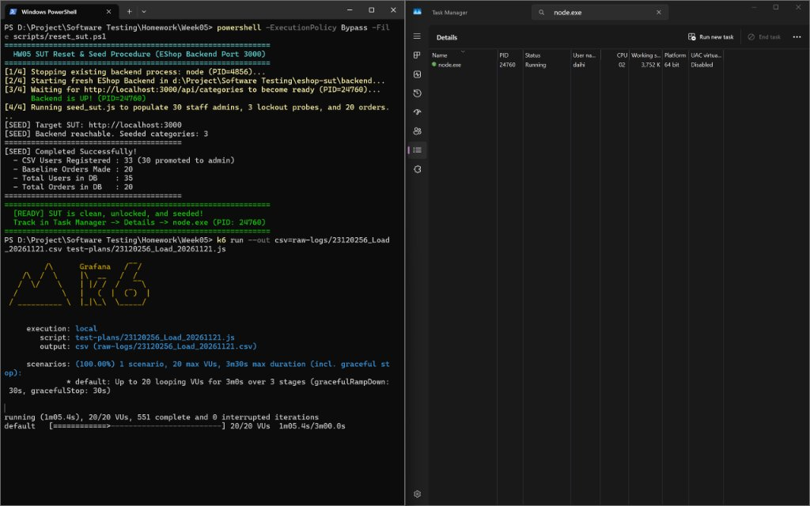

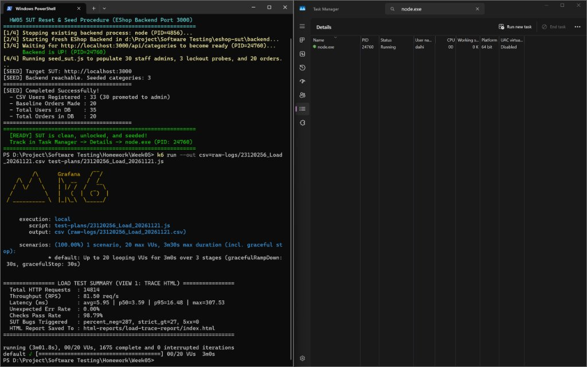

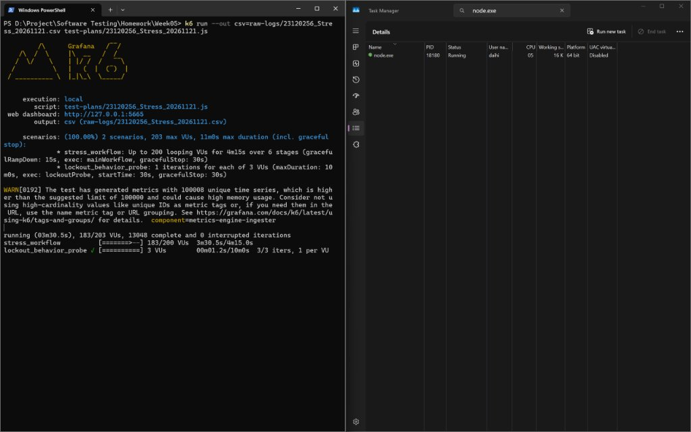

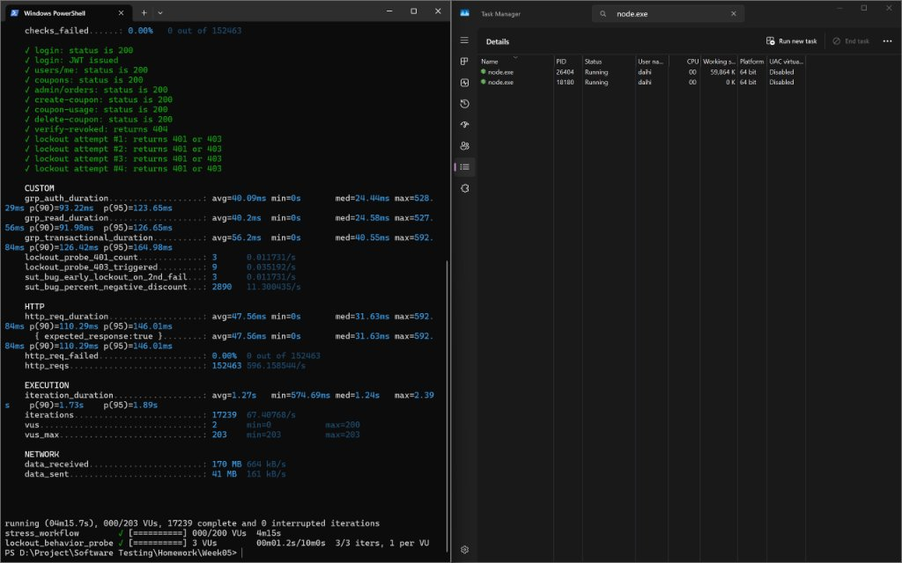

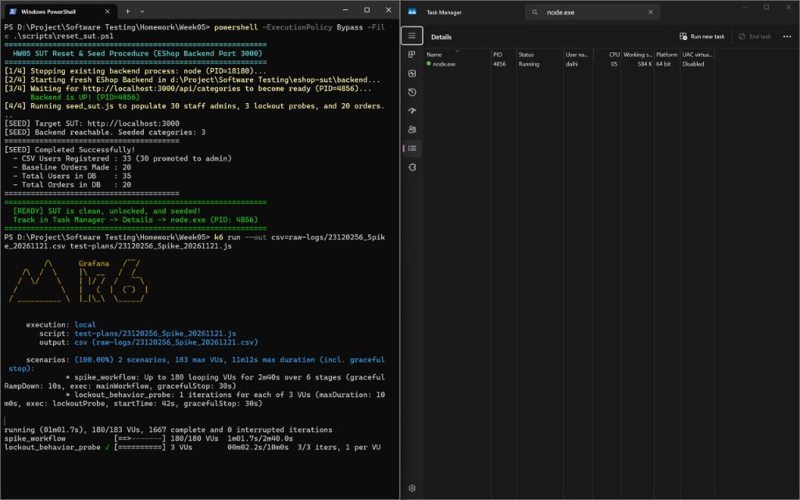

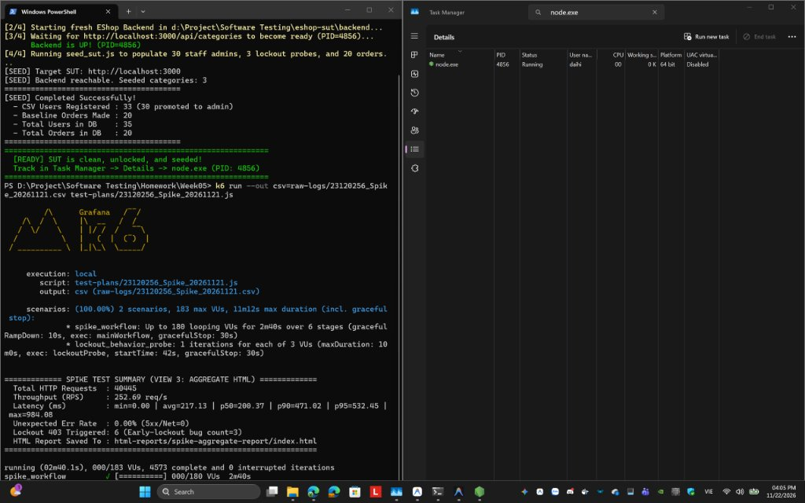

### 3.5 Thực Nghiệm Endurance / Soak Test (12 Phút, 40 VUs) & Ngưỡng Phần Cứng
- **Tổng khối lượng:** `183,756` HTTP requests (`20,779` iterations, `2,334,720` raw CSV rows), `0.00%` lỗi `5xx`, **0 cảnh báo high-cardinality** nhờ bổ sung `tags: { name: 'DELETE /api/admin/coupons/:id' }`.
- **Ngưỡng chịu tải bền vững trên `TRAN_DAI_HIEP`:**
  - **Max Stable Sustained RPS:** **`254.86 req/s`** *(Peak 1s: **`322 req/s`**)*.
  - **Độ trễ 12 phút:** `avg = 14.41 ms`, `p50 = 7.18 ms`, **`p95 = 42.34 ms`**, `p99 = 128.70 ms`, `max = 1,216.07 ms` *(tail spike `1.22s` xuất hiện ở cửa sổ cuối `605s–721s` khi `coupon_usage` đạt `17,524` dòng & kích hoạt V8 major GC / SQLite sync flush)*.
  - **CPU Ceiling (`node.exe` PID `6304` — 24 mẫu 30s/lần):** `Avg = 3.70%` | **`Peak = 4.47%`** *(≈ 71.5% của 1 nhân logic)*.
  - **Memory Ceiling (`node.exe`):** `55.41 MB` (0s) → `172.40 MB` (60s warm-up) → **`177.11 MB` Peak Working Set** (`213.23 MB` Peak Private Memory; tốc độ tăng sau warm-up chỉ **`+0.45 MB/phút`**, Handles ổn định `249–250` → không có memory leak mất kiểm soát trên luồng Coupon/Order).

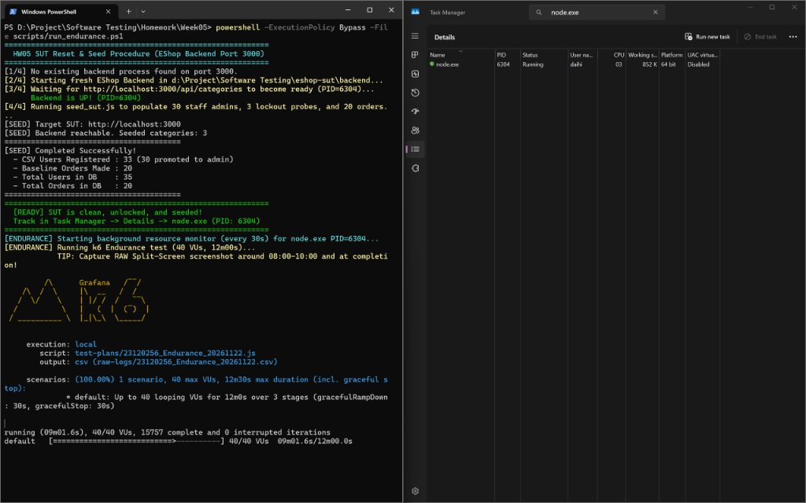

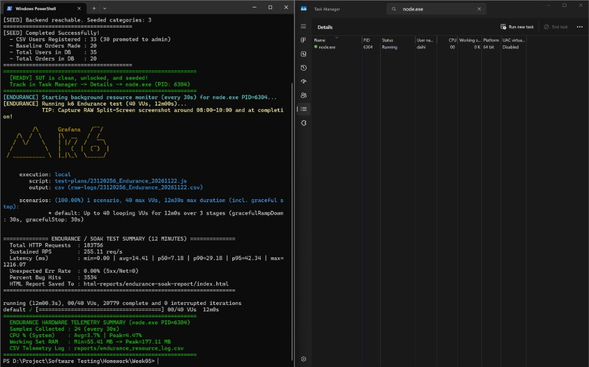

### 3.6 Báo Cáo 4 Lỗi Thực Tế Trên GitHub Issues
Tất cả 4 lỗi đều phát hiện trực tiếp trong các phiên chạy k6 và đã được đăng kèm labels màu + ảnh RAW thật tại [https://github.com/Hidebray/SoftwareTesting_HW05_23120256/issues](https://github.com/Hidebray/SoftwareTesting_HW05_23120256/issues):

| Issue | Bug ID | Mô tả & Bằng chứng định lượng | Labels |
|---|---|---|---|
| [#1](https://github.com/Hidebray/SoftwareTesting_HW05_23120256/issues/1) | `BUG-HW05-01` | `server.js:54` cộng `login_attempts + 2` → khóa `403` ngay lần sai thứ 2 (Stress & Spike: `3/3` tài khoản probe dính lỗi). | `bug`, `high-priority` |
| [#2](https://github.com/Hidebray/SoftwareTesting_HW05_23120256/issues/2) | `BUG-HW05-02` | `server.js:399` công thức `total * (1 - discount_value)` sinh giảm giá âm, đội giá 10x (Load: `287`, Stress: `2,890`, Endurance: `3,534` hits). | `bug`, `critical` |
| [#3](https://github.com/Hidebray/SoftwareTesting_HW05_23120256/issues/3) | `BUG-HW05-03` | `server.js:379` dùng `>` thay vì `>=` ở `min_order_amount` (Load: `27` lần từ chối sai `400` tại biên `300k`/`500k`). | `bug`, `medium-priority` |
| [#4](https://github.com/Hidebray/SoftwareTesting_HW05_23120256/issues/4) | `BUG-HW05-04` | Nút cổ chai `POST /api/apply-coupon` (`p95` nhảy **37.7x**: `17.22ms` → `202.50ms` Stress → `648.92ms` Spike; max `1,109ms` Endurance) do thiếu index `coupon_usage(coupon_id, user_id)` & SQLite thiếu WAL. | `performance`, `high-priority` |

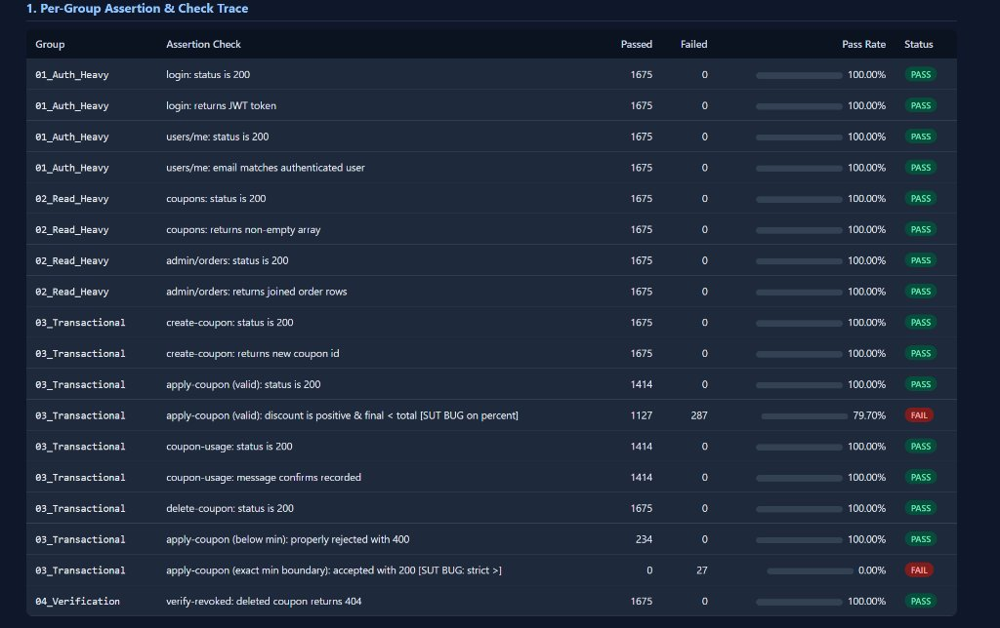

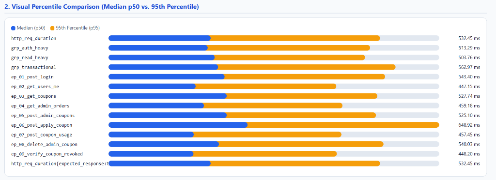

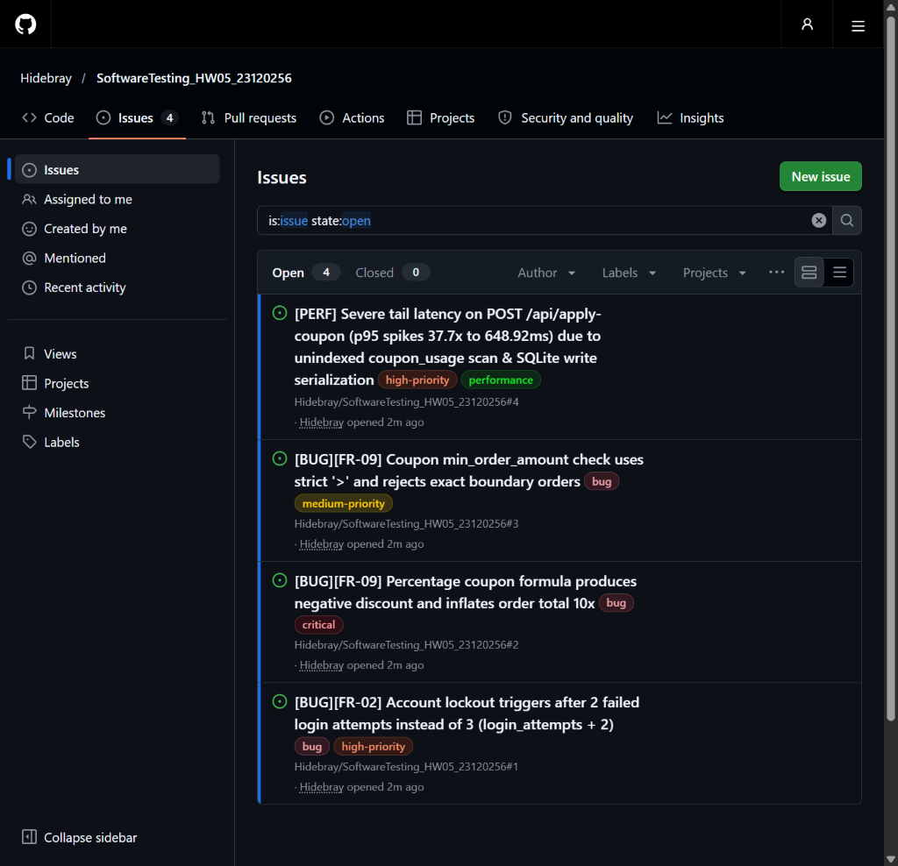

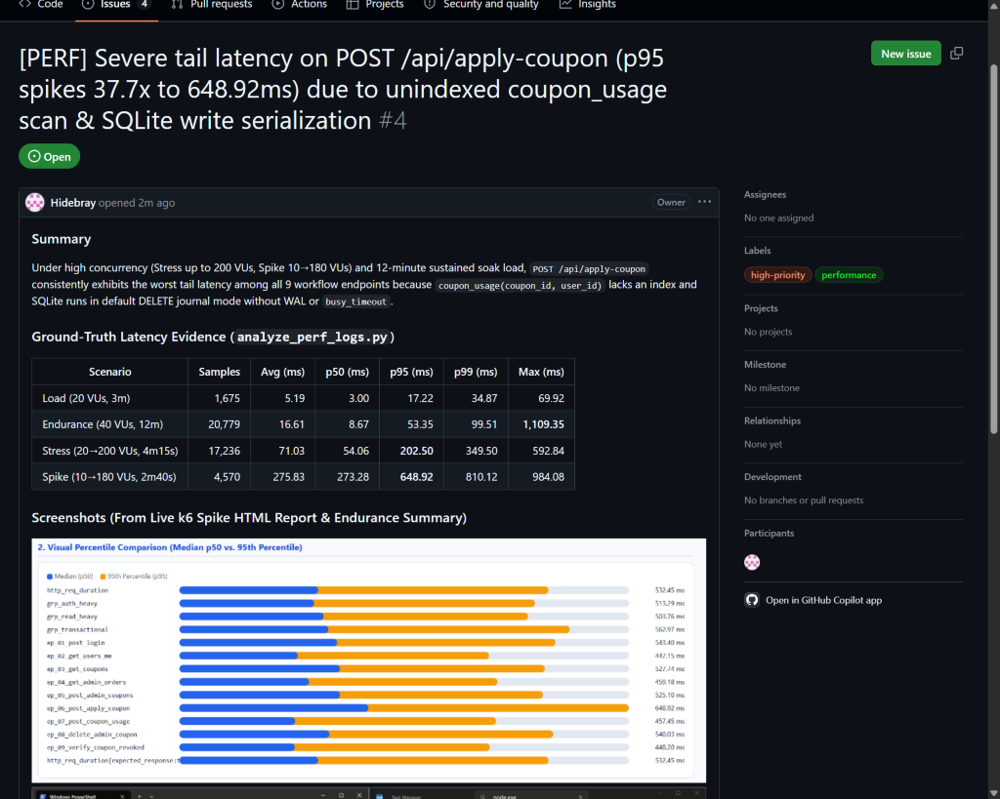

---

## 4. Task 2 — Phân Tích AI, Săn Lỗi Hiểu Sai (Misinterpretation Hunt) & Thẩm Định Tối Ưu

Sử dụng phiên AI độc lập **`Gemini Flash`** (`raw-log-ai-analyst`, chỉ được cung cấp metadata & trích đoạn nguyên bản từ `raw-logs/*.jtl` và `.csv`, **không** được đọc mã nguồn backend hay chạy script Python) để thu bản phân tích nguyên bản, sau đó kiểm chứng bằng Ground-Truth `analyze_perf_logs.py` và mã nguồn thật `server.js` / `database.js` *(chi tiết đầy đủ tại [03_task2_ai_analysis_and_misinterpretation_hunt.md](03_task2_ai_analysis_and_misinterpretation_hunt.md))*:

### 4.1 Bảng Săn Lỗi Hiểu Sai Metric Của AI (`M-01 → M-06`)

| ID | Nhận định sai / điểm mù của AI (`Gemini Flash`) | Giá trị ĐÚNG từ Raw Log gốc | Giải thích lỗi |
|---|---|---|---|
| **M-01** | Trích đoạn khiến **Stress (`Avg = 3.155 ms`) trông nhanh hơn Load (`5.550 ms`)** và Spike (`6.875 ms`). | Load `Avg = 5.951 ms` (`p95 = 16.48 ms`); Stress **`Avg = 47.563 ms` (15.1x)** (`p95 = 146.01 ms`); Spike **`Avg = 217.128 ms` (31.6x)** (`p95 = 532.45 ms`). | Context truncation chỉ thấy giây khởi động/hạ tải `1 VU`, bỏ lọt `99.99%` đỉnh tải 150–200 VUs. |
| **M-02** | Xác định sai endpoint chậm nhất ở Stress & Spike là **`post_admin_coupons`**. | Endpoint chậm nhất cả 2 bài là **`post_apply_coupon`**: Stress `p95 = 202.50 ms` (max `592.84 ms`), Spike **`p95 = 648.92 ms`** (max `984.08 ms`). | Tại `t=0s` bảng `coupon_usage` rỗng nên `post_apply_coupon` nhanh (`2.03 ms`), nhưng chậm nhất khi bảng phình to không có index. |
| **M-03** | Đề xuất ngưỡng SLA Spike `p95 <= 50 ms`, hồi phục `<= 1.2x` trong `15s`. | Spike thực tế `p95 = 532.45 ms` (**gấp 10.6x** ngưỡng AI); cửa sổ `108–135s` hồi phục về `21.51 ms` (**`1.59x`** baseline `13.57 ms`). | Ngoại suy ngưỡng từ mẫu `1 VU`, sẽ gây `100%` false alarm trên CI/CD. |
| **M-04** | Chỉ báo Mean RPS (`82.3` / `597.9` / `252.8`) và span lệch 1s (`181/253/157s`). | Inclusive duration `182/254/158s`; **Peak 1s RPS** thực tế đạt **`119`** (Load), **`1,278`** (Stress — **2.13x** mean), **`946`** (Spike — **3.74x** mean). | Trung bình toàn bài che khuất công suất đỉnh thực sự dội vào backend. |
| **M-05** | Báo `0` lỗi khác trong mẫu ngoài `404` verify. | Stress có `2,673 × 400`, `3 × 401`, `9 × 403`; Spike có `697 × 400`, `6 × 401`, `6 × 403` nằm giữa log. | Các lệnh `lockout_probe` chạy ở `t=30s/42s` nằm ngoài HEAD/TAIL snippet. |
| **M-06** | Phóng đại `http_req_blocked = 22.21 ms` ở dòng 1 thành nút cổ chai P2. | Ngay dòng 19 cùng giây `1795332525`, `http_req_blocked = 0.000 ms`; toàn bộ `152,463` reqs có `0` lỗi socket. | Nhầm cold TCP handshake lần đầu với lỗi cạn kiệt socket/connection pool. |

### 4.2 Thẩm Định 8 Đề Xuất Tối Ưu Của AI (`Feasible` vs. `Hallucinated`)

| # | Đề xuất của AI | Phân loại | Bằng chứng mã nguồn (`eshop-sut/backend/`) |
|:---:|---|:---:|---|
| **P1** | Atomic `UPDATE coupons SET used_count = used_count + 1 ... RETURNING *` | **Hallucinated** *(sai schema & SQL)* | `database.js:29-46` không có cột `used_count`/`max_uses` và không dùng cú pháp PostgreSQL `$1`/`RETURNING *`. |
| **P2** | Database Connection Pool (`min: 10, max: 30–50`) | **Hallucinated** *(sai DBMS)* | `database.js:1-11` dùng **`sqlite3` đơn file** 1 handle duy nhất; SQLite cần `PRAGMA journal_mode = WAL; PRAGMA busy_timeout = 5000;`, không dùng pool 30–50. |
| **P3** | Composite index `coupon_usage(coupon_id, user_id)` & `orders(user_id)` | **Feasible** *(Hiệu quả #1)* | Đánh trúng nút cổ chai `post_apply_coupon` (`648.92 ms` Spike)! *(Chi tiết nhỏ: `coupons.code` đã `UNIQUE`, cột `deleted_at` không tồn tại.)* |
| **P4** | Cache ngắn hạn (In-Memory / Redis) cho `/api/users/me` & `/api/coupons` | **Feasible** *(In-Memory)* / **Hallucinated** *(Redis)* | Node `Map` cache ngắn hạn kèm invalidation là khả thi; dựng cụm Redis ngoài là over-engineering. |
| **P5** | Offload **`bcrypt` / `argon2id`** sang worker threads (`UV_THREADPOOL_SIZE`) | **Hallucinated** *(ảo giác 100%)* | `package.json` không cài `bcrypt`/`argon2`; `server.js:46` so sánh mật khẩu **plaintext** (`user.password === password`)! AI bị đánh lừa bởi tên group `::01_Auth_Heavy`. |
| **P6** | Keyset Pagination (`LIMIT`) & projection cho `/api/admin/orders` & `/api/coupons` | **Feasible** | `server.js:357, 511-518` hiện đều `SELECT *` không có `LIMIT`. |
| **P7** | **PostgreSQL MVCC Autovacuum** (`autovacuum_vacuum_scale_factor = 0.05`) | **Hallucinated** *(nhầm PostgreSQL)* | Tham số độc quyền của PostgreSQL; EShop dùng SQLite3. |
| **P8** | **`statement_timeout = 2000ms`**, Rate Limit & `503` Backpressure | **Bán phần** *(Feasible Express / Hallucinated PG param)* | `statement_timeout` là của PostgreSQL; Express rate-limit & HTTP timeout là khả thi. |

*(Tối ưu cực quan trọng AI bỏ sót: bật **SQLite WAL + `busy_timeout`** và chỉ `UPDATE users SET login_attempts = 0` khi `login_attempts > 0`, loại bỏ ~`17,236` lệnh ghi thừa ở Stress!)*

---

## 5. Task 3 — Đề Xuất Mô Hình Continuous Performance Testing (Bloom-AI G9.6)

*(Chi tiết đầy đủ & GitHub Actions YAML tại [04_task3_continuous_performance_testing.md](04_task3_continuous_performance_testing.md))*

### 5.1 Kiến Trúc Phân Tầng 3 Cấp (Commit-Aware Tiered CPT)
- **Tier 0 (Skip — `0s`):** Commit chỉ sửa `docs/`, `README.md`, `*.css` → bỏ qua perf test.
- **Tier 1 (PR Quick Perf Gate — `~90s`):** Commit chạm `backend/server.js`, routes, middleware → chạy k6 Smoke Load (`15 VUs, 60s`) trên container sạch + `analyze_perf_logs.py`.
- **Tier 2 (Nightly `02:00 AM` / Release Tag / Đổi `database.js` — `~22m`):** Chạy trọn bộ Load + Stress + Spike + Endurance 12 phút.

### 5.2 Sơ Đồ Luồng Continuous Performance Testing (Flowchart)

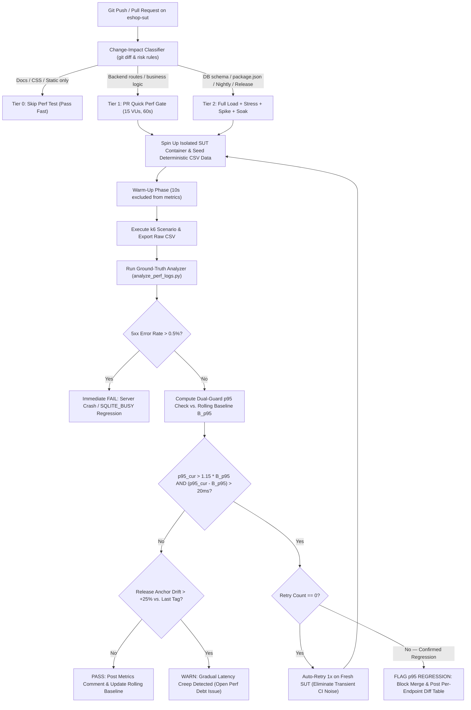

### 5.3 Phát Hiện Suy Giảm `p95` & Phân Tích Trade-Offs
- **Dual-Guard Statistical Rule:** Chỉ gắn cờ suy giảm khi $\text{p95}_{\text{current}} > 1.15 \times B_{p95}$ **VÀ** $(\text{p95}_{\text{current}} - B_{p95}) > 20\text{ ms}$ (với $B_{p95}$ là trung vị 5 lần chạy `main` gần nhất), kết hợp **Release Anchor Guard (`+25%`)** chống trôi baseline tích lũy và **Auto-Retry 1x** chống nhiễu runner.
- **Trade-offs cốt lõi:**
  1. **Chi phí CI & thời gian chờ PR vs. Độ phủ lỗi sớm:** Tier 0/1 cắt >90% chi phí so với chạy full 22m mỗi commit mà vẫn chặn sớm suy giảm backend trong 90 giây.
  2. **False Alarms vs. False Negatives:** Shared cloud runners dễ biến thiên CPU 15–30%; điều kiện tuyệt đối `> 20 ms` + warm-up 10s + Auto-Retry 1x triệt tiêu phần lớn cảnh báo giả mà vẫn nhạy với suy giảm thật.
  3. **Dung lượng lưu trữ Artifact:** Lưu JSON Ground-Truth (`~7 KB`/run) dài hạn làm chuỗi thời gian baseline; chỉ lưu raw CSV/JTL trong 7–14 ngày.

---

## 6. Agent Skill Tái Sử Dụng (`performance-tester` `v1.0 → v1.1`)

- **Thiết kế chuẩn Progressive Disclosure & 100% Tool-Agnostic:** Lưu tại `skills/performance-tester/` (gồm `SKILL.md` lõi 6 pha độc lập công cụ, `references/adapters/{k6,jmeter}_adapter.md`, `scripts/analyze_perf_logs.py` tự nhận diện cả k6 CSV & JMeter `.jtl`, `scripts/convert_k6_to_jtl.py`, và 2 template HTML offline).
- **Vòng tiến hóa thực tế `v1.0 → v1.1`:** Sau khi áp dụng `v1.0` trực tiếp cho HW05, 3 bài học thực chiến đã được cập nhật vào `v1.1`: (1) **URL High-Cardinality `name` Tag Guard**, (2) **Dual-Stack IPv4/IPv6 Reset Hygiene**, và (3) **DBMS & Auth Hallucination Verification Gate**.
- **Chứng minh tái sử dụng end-to-end trên nhóm Endpoint mới (`skill-demo/`):** Áp dụng `v1.1` lên **Admin Product Catalog & Bulk CSV Import (Pool C FR-15 & FR-16)** (`POST /api/login` → `GET /api/products` → `POST /api/products` → `PUT /api/products/:id` → `POST /api/admin/import-products` → `DELETE /api/products/:id`) — chạy thật 25s đạt **`1,632` HTTP requests (`62.77 req/s`, `0.00%` lỗi, 0 warning high-cardinality)** và chỉ ra ngay nút cổ chai mới `post_bulk_import` (`p95 = 59.81 ms`, `max = 178.74 ms`).

---

## 7. Phụ Lục Bắt Buộc
- **AI Audit Report:** [AI/AI_Audit.md](../AI/AI_Audit.md) | [AI/AI_Audit.pdf](../AI/AI_Audit.pdf)
- **AI Critique (200–300 từ):** [AI/AI_Critical.md](../AI/AI_Critical.md) | [AI/AI_Critical.pdf](../AI/AI_Critical.pdf)
- **Git Commit Log:** [git-commit-log.txt](../git-commit-log.txt)
- **Public GitHub Repo:** [https://github.com/Hidebray/SoftwareTesting_HW05_23120256](https://github.com/Hidebray/SoftwareTesting_HW05_23120256)
