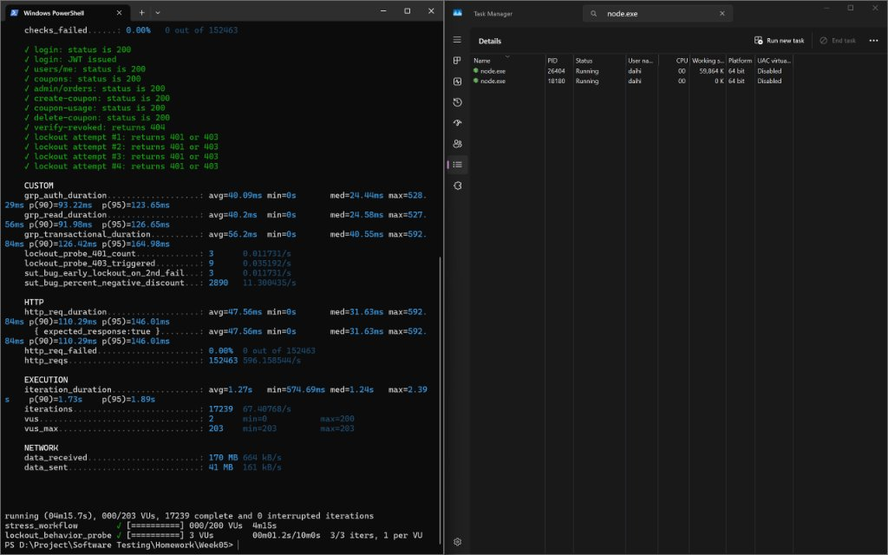
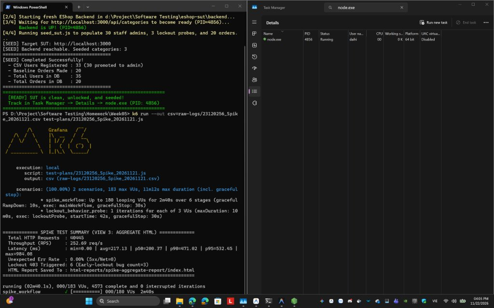
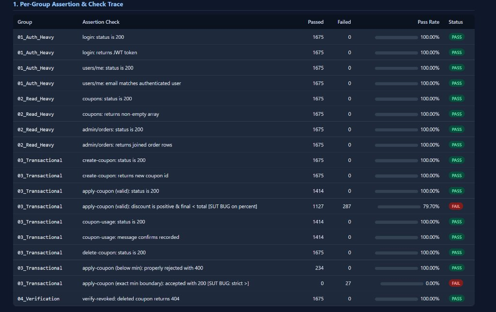
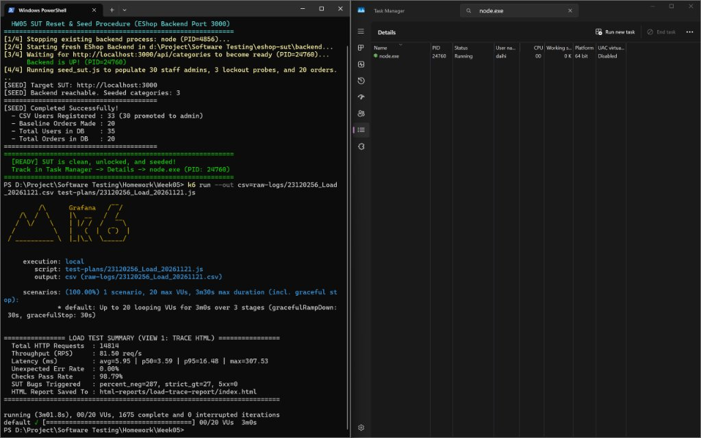
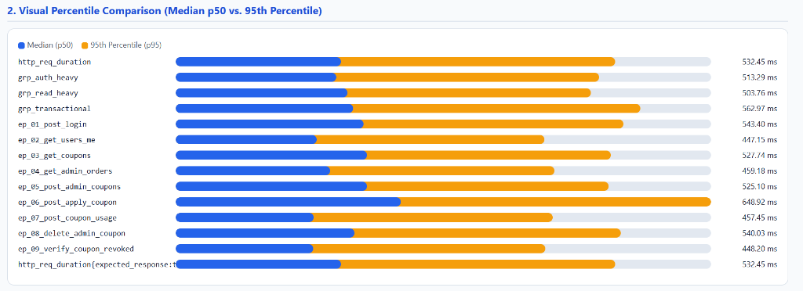
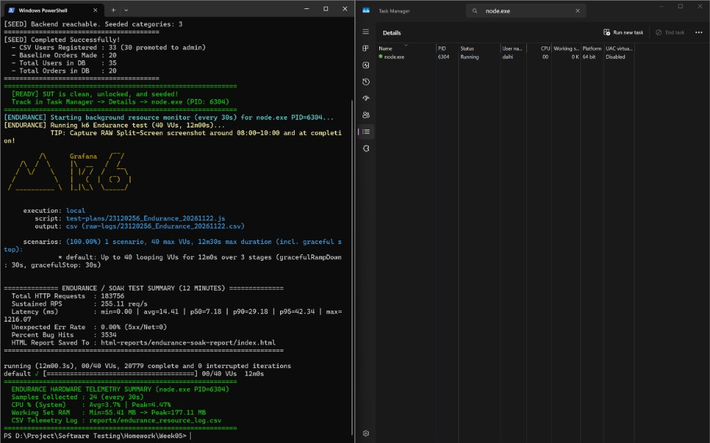

# GitHub Issues Ready-to-Post Templates (4 Bugs Captured Directly From k6 Runs — HW05 / 23120256)

> Copy-paste từng issue dưới đây lên mục **Issues** trên Public GitHub Repository của bạn và **kéo-thả ảnh minh chứng RAW thật từ các phiên chạy k6** vào vị trí `[KÉO-THẢ ẢNH TẠI ĐÂY]` trực tiếp trên trình soạn thảo GitHub!

---

## Issue #1
- **Title:** `[BUG][FR-02] Account lockout triggers after 2 failed login attempts instead of 3 (login_attempts + 2)`
- **Labels:** `bug`, `high-priority`
- **Ảnh thật cần kéo-thả vào Issue (đã có sẵn trong `proof-image/`):**
  1. `proof-image/stress_summary_and_monitor.png`
  2. `proof-image/spike_summary_and_monitor.png`
- **Body:**
```markdown
### Summary
Failed login attempts increment `users.login_attempts` by `+2` instead of `+1`, causing accounts to lock (`HTTP 403`) after only **2 failed attempts** instead of the specified 3 attempts.

### Location
`eshop-sut/backend/server.js` (lines 54–58):
```js
const newAttempts = user.login_attempts + 2;
if (newAttempts >= 3) {
  lockedUntil = new Date(Date.now() + 180000).toISOString();
}
```

### Direct Evidence Captured During k6 Stress & Spike Runs
- Isolated `lockout_behavior_probe` scenario (3 clean accounts `locktest01..03@eshop.com`, 4 consecutive wrong-password attempts each):
- **Stress test (`23120256_Stress_20261121.csv`):** `sut_bug_early_lockout_on_2nd_fail = 3` (all 3/3 accounts locked early).
- **Spike test (`23120256_Spike_20261121.csv`):** `post_login_lockout_probe` returned `6 × HTTP 401` and `6 × HTTP 403` (`Early-lockout bug count = 3`).
- Attempt #3 already received `403 Tài khoản đã bị khóa` because Attempt #1 set `login_attempts = 2` and Attempt #2 set `login_attempts = 4 >= 3`.

### Screenshots (From Live k6 Runs)



### Suggested Fix
Change `user.login_attempts + 2` to `user.login_attempts + 1`.
```

---

## Issue #2
- **Title:** `[BUG][FR-09] Percentage coupon formula produces negative discount and inflates order total 10x`
- **Labels:** `bug`, `critical`
- **Ảnh thật cần kéo-thả vào Issue:**
  1. `proof-image/bug_02_03_load_trace_html.png` *(chụp từ `html-reports/load-trace-report/index.html`)*
  2. `proof-image/load_summary_and_monitor.jpg` *(đã có sẵn)*
- **Body:**
```markdown
### Summary
Applying a percentage coupon (`type = "percent"`, e.g. `10` for 10%) computes `discount_amount = Math.floor(total_amount * (1 - coupon.discount_value))`, yielding a **negative discount** and inflating `final_amount` by **10x** (or 15x/20x).

### Location
`eshop-sut/backend/server.js` (lines 398–406)

### Direct Evidence Captured During k6 Load, Stress & Endurance Runs
- **Load test (`14,814` requests):** Semantic check `discount_amount > 0 && final_amount < totalAmount` failed **287 times** across `PCT10`, `PCT15`, `PCT20` coupons (`percent_neg = 287`).
- **Stress test (`152,463` requests):** Confirmed **2,890 occurrences** (`sut_bug_percent_negative_discount = 2890`).
- **Endurance 12m test (`183,756` requests):** Confirmed **3,534 occurrences**.

### Screenshots (From Live k6 Runs & View 1 HTML Report)



### Suggested Fix
```js
discount_amount = Math.floor((total_amount * coupon.discount_value) / 100);
```
```

---

## Issue #3
- **Title:** `[BUG][FR-09] Coupon min_order_amount check uses strict '>' and rejects exact boundary orders`
- **Labels:** `bug`, `medium-priority`
- **Ảnh thật cần kéo-thả vào Issue:**
  1. `proof-image/bug_02_03_load_trace_html.png` *(chụp từ `html-reports/load-trace-report/index.html`)*
  2. `proof-image/load_summary_and_monitor.jpg` *(đã có sẵn)*
- **Body:**
```markdown
### Summary
`POST /api/apply-coupon` validates `total_amount > coupon.min_order_amount` instead of `>=`, falsely rejecting valid orders whose total equals the exact minimum threshold (e.g., `300,000 ₫` or `500,000 ₫`).

### Location
`eshop-sut/backend/server.js` (line 379)

### Direct Evidence Captured During k6 Load Run
- **Load test (`23120256_Load_20261121.csv`):** Boundary rows `RED-13` (`300000`) and `RED-14` (`500000`) triggered **27 false HTTP 400 rejections** (`strict_gt = 27`).

### Screenshots (From Live k6 Load Run & View 1 HTML Report)


### Suggested Fix
Change `if (total_amount > coupon.min_order_amount)` to `if (total_amount >= coupon.min_order_amount)`.
```

---

## Issue #4
- **Title:** `[PERF] Severe tail latency on POST /api/apply-coupon (p95 spikes 37.7x to 648.92ms) due to unindexed coupon_usage scan & SQLite write serialization`
- **Labels:** `performance`, `high-priority`
- **Ảnh thật cần kéo-thả vào Issue:**
  1. `proof-image/bug_04_spike_aggregate_html.png` *(chụp từ `html-reports/spike-aggregate-report/index.html`)*
  2. `proof-image/endurance_summary.jpg` *(đã có sẵn)*
- **Body:**
```markdown
### Summary
Under high concurrency (Stress up to 200 VUs, Spike 10→180 VUs) and 12-minute sustained soak load, `POST /api/apply-coupon` consistently exhibits the worst tail latency among all 9 workflow endpoints because `coupon_usage(coupon_id, user_id)` lacks an index and SQLite runs in default DELETE journal mode without WAL or `busy_timeout`.

### Ground-Truth Latency Evidence (`analyze_perf_logs.py`)
| Scenario | Samples | Avg (ms) | p50 (ms) | p95 (ms) | p99 (ms) | Max (ms) |
|---|---:|---:|---:|---:|---:|---:|
| Load (20 VUs, 3m) | 1,675 | 5.19 | 3.00 | 17.22 | 34.87 | 69.92 |
| Endurance (40 VUs, 12m) | 20,779 | 16.61 | 8.67 | 53.35 | 99.51 | **1,109.35** |
| Stress (20→200 VUs, 4m15s) | 17,236 | 71.03 | 54.06 | **202.50** | 349.50 | 592.84 |
| Spike (10→180 VUs, 2m40s) | 4,570 | 275.83 | 273.28 | **648.92** | 810.12 | 984.08 |

### Screenshots (From Live k6 Spike HTML Report & Endurance Summary)



### Suggested Fix
1. Enable SQLite WAL mode (`PRAGMA journal_mode = WAL; PRAGMA busy_timeout = 5000;`) in `database.js`.
2. Add indexes: `CREATE INDEX idx_coupon_usage_pair ON coupon_usage(coupon_id, user_id);` and `CREATE INDEX idx_users_email ON users(email);`.
```
